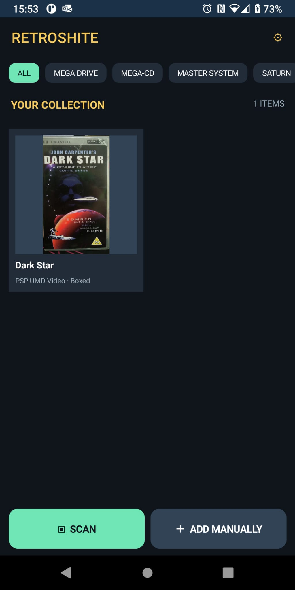
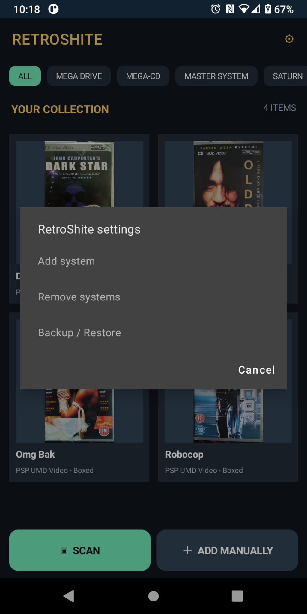
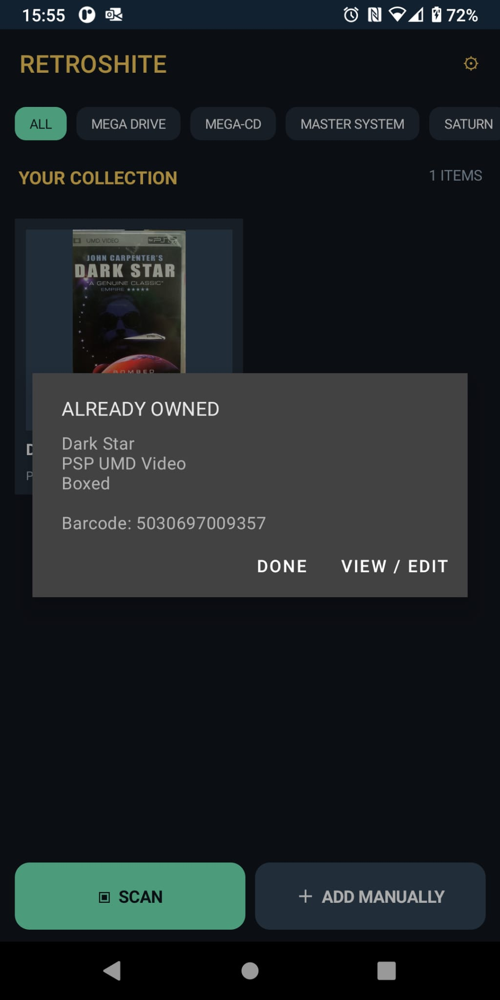
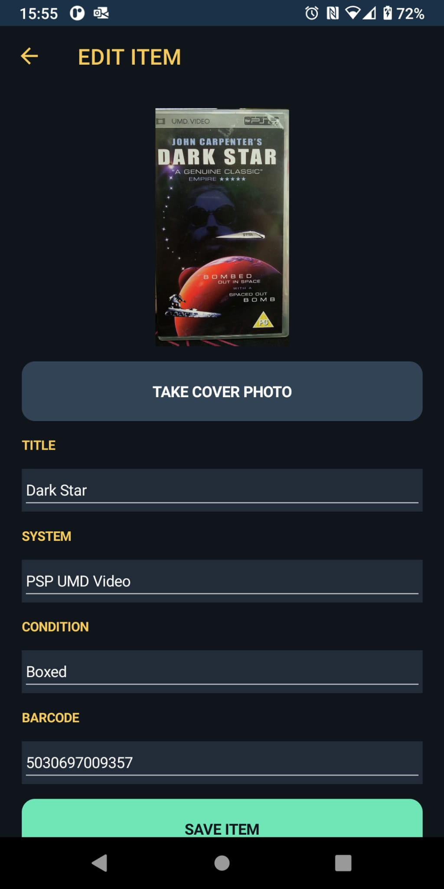
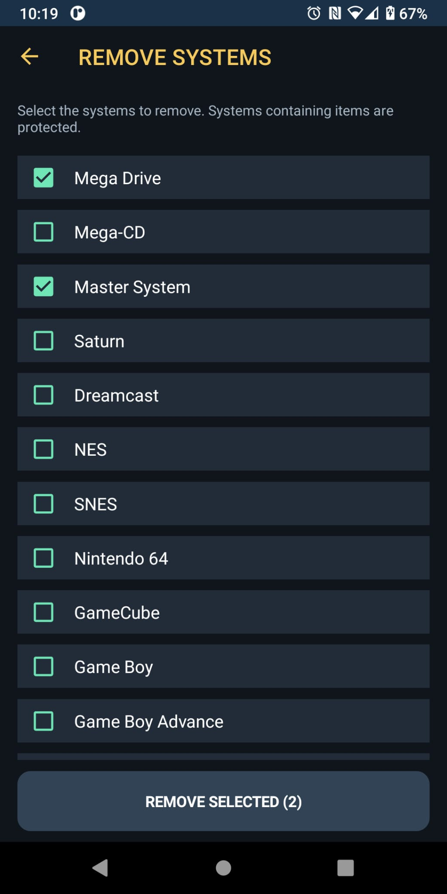
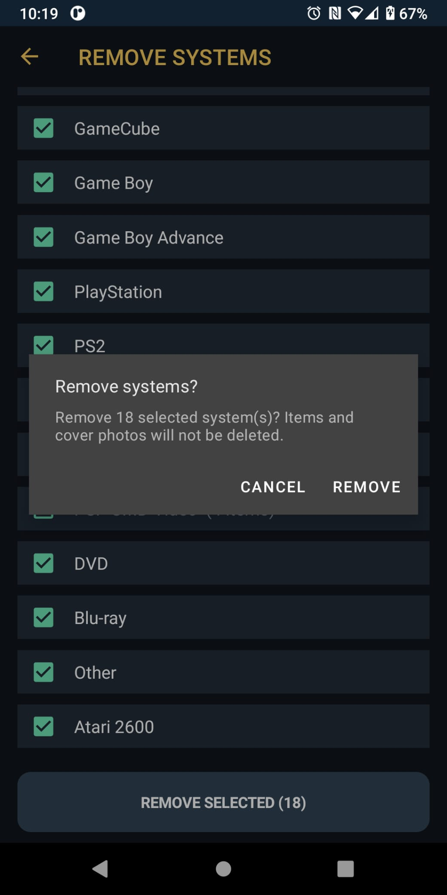
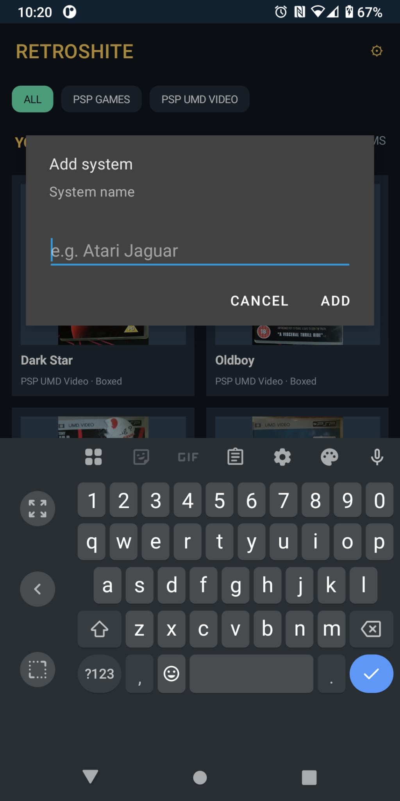
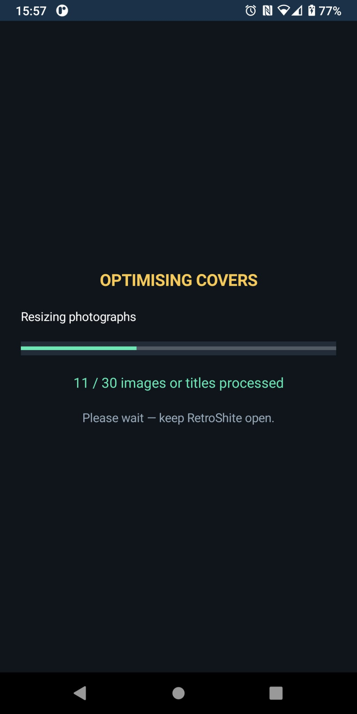
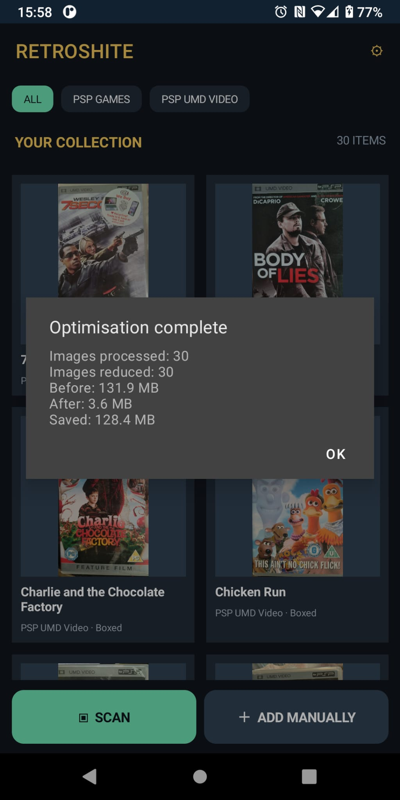

# RetroShite — Android Collection Database

**Stop buying the same shite twice.**

RetroShite is an offline Android app for cataloguing physical games, movies and other media. Scan a barcode to check whether an item is already in your collection, or add it manually.

## Screenshots

| Collection | Settings | Duplicate check | Item editor |
|:--:|:--:|:--:|:--:|
|  |  |  |  |

| Remove systems | Confirm removal | Add system |
|:--:|:--:|:--:|
|  |  |  |

| Optimising covers | Optimisation results |
|:--:|:--:|
|  |  |

## Features

- Barcode scanning with local duplicate detection
- Manual item entry for loose cartridges and items without barcodes
- Camera capture for cover art
- Automatically resize new cover photographs to 1200 pixels maximum, JPEG quality 80%
- Optimise stored cover images from Settings, with live progress and space-saved summary
- System/category filters and custom categories
- Remember the last system used when adding another item during the same app session
- Remove multiple unused systems from Settings; systems containing items are protected
- Removed default systems stay removed after restarting
- Item title, condition, system and barcode fields
- Local SQLite storage, without accounts or a cloud service
- ZIP export with live progress and a completion message
- Merge ZIP backups from another device, adding missing titles and categories without overwriting the local collection
- Optional full replacement restore for moving to a new device

## Requirements

- Android 11 (API 30) or later
- ARM64 APK for ARM64 devices

## Build from source

Open `src/RetroShite/RetroShite.csproj` in Visual Studio 2022 with the .NET MAUI Android workload installed, or use the .NET 8 SDK with the Android workload.

From `src/RetroShite`:

```powershell
dotnet restore
dotnet publish RetroShite.csproj -f net8.0-android -c Debug -r android-arm64 -p:AndroidPackageFormat=apk
```

For distribution, build and sign an Android APK using your own signing configuration. Keep the signing key private and use the same signing identity for updates.

## Data

Collection records and custom categories are stored in an app-private SQLite database; cover images are saved locally. Use **Settings → Backup / Restore** to export a ZIP to Downloads, merge an existing ZIP into the current collection, or replace the collection entirely. Merging skips matching barcodes; for items without barcodes it compares system, title and condition. Different barcodes are kept as separate editions, even when the title is the same. Older backups remain compatible. **Settings → Optimise cover images** reduces the size of photographs already stored on the device; back up before optimising.

## Licence

MIT — see [LICENSE](LICENSE). Third-party dependencies retain their own licences.
