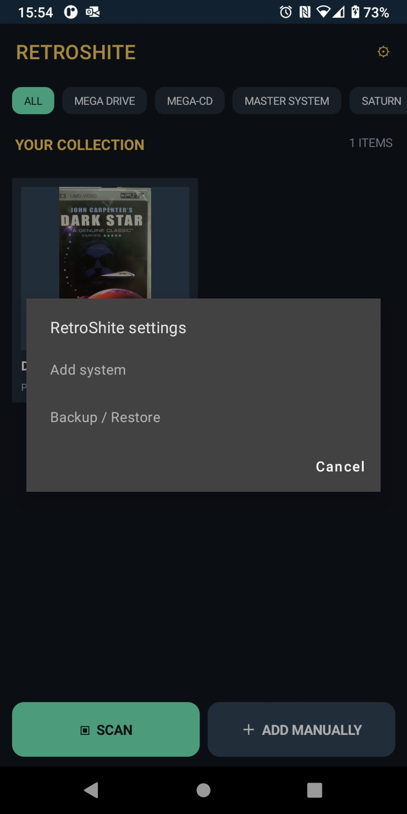

# RetroShite — Android Collection Database

RetroShite is a small, **offline Android catalogue for your physical games and media**. It was born from accidentally buying the same PSP UMD movie twice. Scan a barcode before buying another copy; if it's already in your collection, RetroShite tells you.

No account, cloud backend, adverts, subscriptions, or online metadata lookup. Your catalogue stays on your phone.

*Stop buying the same shite twice.*

## Screenshots

| Collection | Settings | Already owned | Edit item |
|:--:|:--:|:--:|:--:|
|  |  |  |  |

## Features

- Scan EAN/UPC barcodes and check for duplicates against your local collection.
- Add items without a barcode (ideal for loose cartridges).
- Photograph your own box art; browse covers in a portrait two-column grid.
- Filter by platform or media type via the horizontal category tabs.
- Add your own systems through the gear menu. Categories persist in SQLite.
- Edit or remove items; record title, system, condition and optional barcode.
- Export the SQLite database and cover photos together as a ZIP to Android Downloads; restore from a ZIP using the file picker.

## Build

The source is a **.NET 8 MAUI Android** project. Open `RetroShite/RetroShite.csproj` in Visual Studio 2022 with the MAUI/Android workload installed.

For an Android ARM64 build, from the project directory:

```powershell
dotnet publish RetroShite.csproj -f net8.0-android -c Debug -r android-arm64 -p:AndroidPackageFormat=apk
```

Use a correctly signed APK when distributing to other devices. Keep the signing keystore private and consistent for future updates.

## Data and backups

Collections are stored in an app-private SQLite database with locally stored JPEG cover images. The settings menu provides manual export/import; ZIP imports replace the current collection, so take an export before restoring.

Custom systems are stored in the same database and included in backups. There is no network service and no automatic barcode lookup.

## Status

**v0.1.2** — initial functional prototype. Barcode scanning, duplicate detection, cover photography, offline storage and custom categories are implemented. Backup export and restore should be verified before relying on them for your only copy of a collection.

## Licence

MIT — see [LICENSE](LICENSE). Third-party libraries retain their respective licences.
